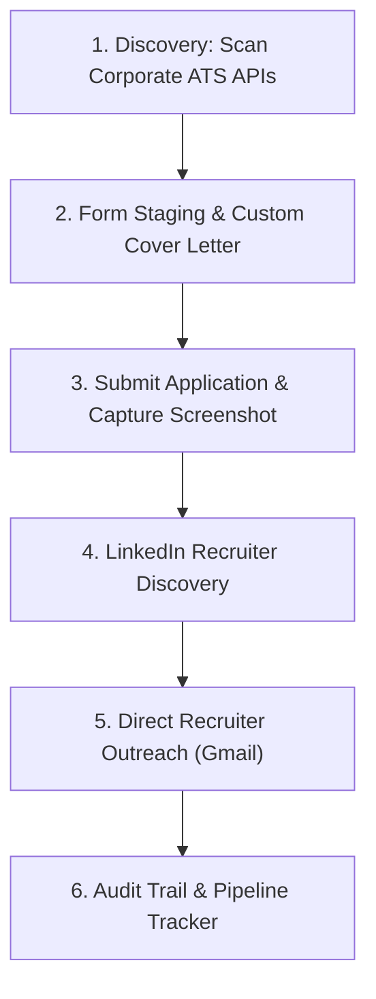

# Auto Job Apply: Autonomous ATS Application & Recruiter Outreach Engine

[](https://opensource.org/licenses/MIT)
[](https://github.com/mrh-jishan/auto-job-apply)
[](https://github.com/mrh-jishan/auto-job-apply)

An autonomous end-to-end job application, ATS portal submission, recruiter discovery, and cold outreach engine built for **Google Antigravity (AGY)** and autonomous coding agents.

Unlike spammy "Easy Apply" bots that submit resumes to aggregators where thousands of applicants compete, **Auto Job Apply** targets direct corporate portals (Greenhouse, Workday, Lever), embeds tailored cover letters directly into the application, discovers the hiring manager or technical recruiter on LinkedIn, and delivers concise, personalized cold outreach via Gmail.

---

## Architecture Overview



---

## Key Features

1. **Direct Corporate ATS Automation**:
   - Native support for **Greenhouse**, **Workday**, and **Lever** enterprise portals.
   - Handles React-Select dropdowns, dynamic location pickers, and Workday synthetic event models.
   - Automatically solves one-time passcode verification emails sent during submission.

2. **Embedded Tailored Cover Letters**:
   - Injects concise, role-matched impact bullets directly into the ATS portal's "Cover Letter" field.
   - Eliminates generic fluff by focusing on quantifiable engineering outcomes.

3. **Recruiter Intelligence & Email Resolution**:
   - Discovers domain-specialized technical recruiters and talent acquisition leaders on LinkedIn using authenticated browser sessions.
   - Derives verified corporate email patterns (`{first_initial}{last}@company.com` or `{first}.{last}@company.com`).

4. **Human-Style Cold Outreach**:
   - Composes punchy, unique emails (under 120 words) matching candidate credentials directly to job requisitions.
   - Strictly enforces zero em dashes for authentic human readability.
   - Automatically attaches PDF resumes and saves visual delivery receipts.

5. **Visual Audit Trail**:
   - Captures high-resolution screenshot receipts for every stage:
     - Form Review (`{company}_application_form.png`)
     - Portal Submission (`{company}_submitted.png`)
     - Outreach Sent Confirmation (`{company}_sent.png`)

---

## Directory Structure

```text
auto-job-apply/
├── SKILL.md                          # Antigravity skill orchestration runbook
├── README.md                         # Project documentation and setup guide
├── LICENSE                           # MIT License
├── references/
│   ├── ats_portals.md                # Workday, Greenhouse & Lever automation quirks & selectors
│   ├── recruiter_discovery.md        # LinkedIn search patterns & corporate email resolution
│   └── outreach_guidelines.md        # Concise cold email & cover letter formulas (0 em dashes)
└── scripts/
    └── scan_fresh_jobs.py            # Automated scanner querying active corporate ATS boards
```

---

## Quickstart & Installation

### Option 1: Install as a Global Antigravity Skill
To make this skill available across all workspaces on your machine:
```bash
git clone https://github.com/mrh-jishan/auto-job-apply.git ~/.gemini/config/skills/auto-job-apply
```

### Option 2: Install into a Project Workspace
To use this skill within a specific repository or project:
```bash
mkdir -p .agents/skills
git clone https://github.com/mrh-jishan/auto-job-apply.git .agents/skills/auto-job-apply
```

### Option 3: Run the Job Scanner Standalone
Query verified tech company boards for fresh active roles:
```bash
python3 scripts/scan_fresh_jobs.py 10
```

---

## How It Works with Antigravity

Once installed, simply activate the skill inside Antigravity by asking:
> *"Apply to 10 senior IAM or cloud security jobs today, include tailored cover letters in the portal, find the recruiters on LinkedIn, and send cold emails."*

The agent will automatically:
1. Scan active corporate job boards.
2. Fill and validate application fields using your resume and profile data.
3. Inject tailored cover letters into portal forms.
4. Submit the applications and capture review screenshots.
5. Identify the dedicated technical recruiter on LinkedIn.
6. Draft and dispatch personalized outreach notes with your resume attached via Gmail.
7. Update your master `job_pipeline_report.md` tracking table.

---

## License

MIT License. See [LICENSE](LICENSE) for details. Built by [Robiul Hassan](https://github.com/mrh-jishan).
