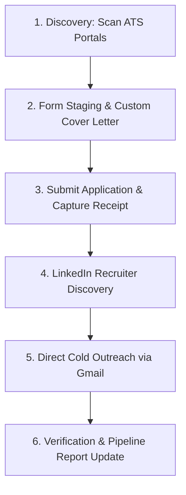

# Autonomous Job Application & Recruiter Outreach Skill

This skill guides the agent through an autonomous pipeline that applies to verified corporate jobs, includes custom cover letters in portal forms, discovers technical recruiters on LinkedIn, and sends personalized cold outreach emails with resume attached via Gmail.

---

## Workflow Overview

---

## Step 1: Discover High-Probability Jobs
1. Prioritize direct Applicant Tracking System (ATS) portals (Greenhouse, Workday, Lever) over aggregators.
2. Use helper script to scan active postings:
   `python3 ./scripts/scan_fresh_jobs.py 10`
3. Filter by target keywords (IAM, Cloud Security, Backend, Identity) and verified remote or preferred locations.

---

## Step 2: Form Staging & Dynamic Inputs
Refer to [ATS Portals Reference](./references/ats_portals.md) for portal-specific patterns.

1. Navigate to the job application URL in Chrome.
2. Populate candidate details:
   - Name, phone, email, location (handling React-Select or dropdowns).
   - Upload target resume PDF.
3. **Always Include Custom Cover Letter**:
   - Locate the "Cover Letter" section on the form.
   - Click "Enter manually" or target the textarea.
   - Insert a concise 3-bullet pitch matching candidate accomplishments directly to the job requirements (refer to [Outreach Guidelines](./references/outreach_guidelines.md)).
4. Capture form review screenshot:
   `/Users/robinhassan/Desktop/{company}_application_form.png`

---

## Step 3: Application Submission
1. Submit the application form (handling Workday synthetic events or standard Greenhouse submit).
2. If the portal sends a one-time verification passcode (e.g. Coinbase), retrieve it from Gmail and enter it.
3. Capture the submission receipt screenshot:
   `/Users/robinhassan/Desktop/{company}_submitted.png`

---

## Step 4: Recruiter Intelligence & Contact Resolution
Refer to [Recruiter Discovery Reference](./references/recruiter_discovery.md).

1. Search LinkedIn for the company's technical recruiter or talent acquisition lead for security/engineering.
2. Extract full name, LinkedIn profile, and derive corporate email address (`{f}{last}@{domain}` or `{first}.{last}@{domain}`).
3. If no verified recipient is found, omit cold outreach.

---

## Step 5: Compose & Send Direct Cold Outreach
1. In Gmail, compose a new draft addressed to the recruiter.
2. Subject format: `{Job Title} (#{Req ID}) - {Candidate Name}`.
3. Body: Under 120 words, human-written, 3 bullet points, zero em dashes.
4. Attach candidate resume PDF.
5. Capture draft screenshot:
   `/Users/robinhassan/Desktop/{company}_gmail_draft.png`
6. Send email and capture confirmation screenshot:
   `/Users/robinhassan/Desktop/{company}_sent.png`

---

## Step 6: Pipeline Reporting & Audit Trail
1. Update `job_pipeline_report.md` with:
   - Company, Role & Req ID, Portal URL, Application status, Recruiter contact info, Sent timestamp, Screenshot links.
2. Strictly verify zero em dashes exist in any text, summary, or report.
